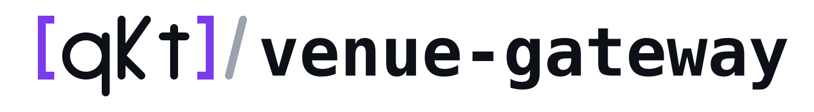
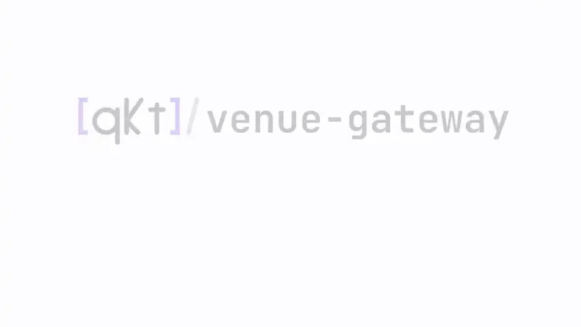

<p align="center">
  <picture>
    <source media="(prefers-color-scheme: dark)" srcset="docs/assets/qkt-venue-gateway-logo-dark.svg">
    
  </picture>
</p>

<h3 align="center">One gateway between qkt and a trading venue.<br/>Futures, perpetuals and options over one small protocol.</h3>

<p align="center">
  <a href="https://github.com/elitekaycy/qkt-venue-gateway/actions/workflows/check.yml"></a>
  <a href="LICENSE"></a>
  <a href="CHANGELOG.md"></a>
  <a href="https://github.com/sponsors/elitekaycy"></a>
</p>

<p align="center">
  <a href="docs/assets/qkt-venue-gateway-full-dark.mp4">
    <picture>
      <source media="(prefers-color-scheme: dark)" srcset="docs/assets/qkt-venue-gateway-loop-dark.webp">
      
    </picture>
  </a>
</p>

<p align="center"><sub>Every command in this clip was run for real, against the paper account.<br/><a href="docs/assets/qkt-venue-gateway-full-dark.mp4">Watch the full walkthrough</a></sub></p>

<br/>

## What it is

One gateway process serves one venue account. qkt places orders and reads market data through it, and a
venue **adapter** does the talking to the venue. An order id is placed at most once, every order and fill
is journaled before it is sent, and a kill switch outside qkt can stop new exposure.

```text
qkt ──VGP v1──▶ qkt-venue-gateway ──adapter──▶ venue (paper, Deribit, Bybit)
```

<br/>

## Quick start

You need Docker and [qkt](https://github.com/elitekaycy/qkt). The paper account trades on Deribit's live prices,
so no venue account is needed.

**1. Start the paper gateway**

```bash
git clone https://github.com/elitekaycy/qkt-venue-gateway
cd qkt-venue-gateway
cp .env.example .env
docker compose up -d
```

**2. Check it is healthy**

Give it a few seconds: `docker compose ps` shows `(healthy)` when it serves.

```bash
source .env
curl -H "Authorization: Bearer $PAPER_TRADER_TOKEN" \
  http://127.0.0.1:8443/v1/health
```

You will see `"adapter":"paper"` and `"venue_connected":true`.

**3. Point qkt at it**

```bash
export PAPER_TRADER_TOKEN
cat > qkt.config.yaml <<'EOF'
brokers:
  paper:
    type: gateway
    gateway_url: http://127.0.0.1:8443
    api_key: env:PAPER_TRADER_TOKEN
    expected_adapter: paper
    expected_account_login: paper
    expected_trade_mode: demo
EOF
```

**4. Send an order**

```bash
cat > first.qkt <<'EOF'
STRATEGY first VERSION 1
SYMBOLS
    btc = PAPER:BTC_USDC_PERPETUAL EVERY 1s
RULES
    WHEN POSITION.btc = 0 AND TRADES.today = 0
    THEN BUY btc SIZING 0.001
EOF

qkt daemon --config qkt.config.yaml >qkt.log 2>&1 &
sleep 5
qkt deploy first.qkt --as first
sleep 5
curl -H "Authorization: Bearer $PAPER_TRADER_TOKEN" \
  http://127.0.0.1:8443/v1/positions
```

The order filled when `positions` lists `BTC_USDC-PERPETUAL` with `"quantity":"0.001"`. The fill itself is at
`/v1/deals`. Stop with `qkt stop first --flatten`, then `qkt daemon stop`.

<br/>

## Next

| I want to | Read |
| --- | --- |
| Change a setting, back up, upgrade | [Running the gateway](docs/running.md) |
| Trade a real account | [Deribit adapter](adapter-deribit/README.md) · [Bybit adapter](adapter-bybit/README.md) |
| Add a venue | [Writing an adapter](docs/writing-an-adapter.md) |
| Call the API | [Wire protocol](docs/vgp-v1-wire.md) |
| Understand the design | [Design](docs/design.md) |
| Read it online | [venuegw.tryqkt.com](https://venuegw.tryqkt.com) |
| Contribute | [CONTRIBUTING.md](CONTRIBUTING.md) · [SECURITY.md](SECURITY.md) |

<br/>

<sub>Apache 2.0 licensed. Part of [qkt](https://github.com/elitekaycy/qkt).</sub>
