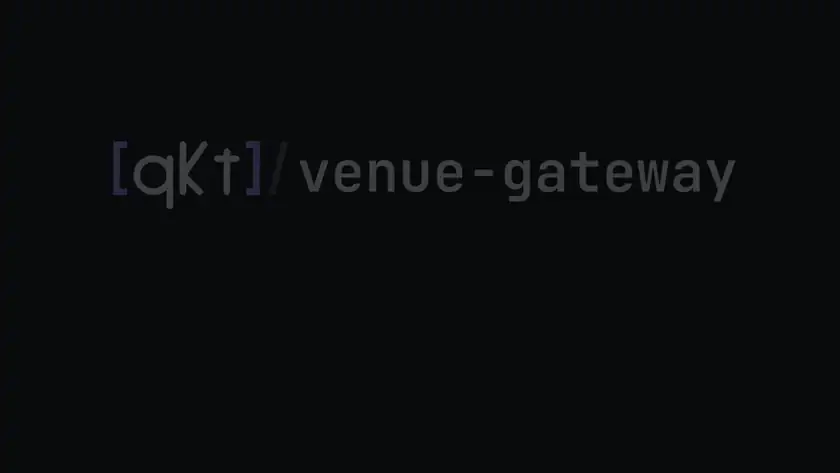

<section class="vgw-hero" markdown="1">



<div class="vgw-hero__pills" markdown="0">
  <span class="pill pill--accent">Apache 2.0</span>
  <span class="pill">VGP v1</span>
  <span class="pill">paper</span>
  <span class="pill">Deribit</span>
  <span class="pill">Bybit</span>
</div>

# One small protocol between qkt and a trading venue — <em>one container per account.</em> { .vgw-hero__lede }

<p class="vgw-hero__sub" markdown="0">
qkt-venue-gateway gives <a href="https://docs.tryqkt.com">qkt</a> one protocol, VGP v1, for futures,
perpetuals, options and spot. An order is placed at most once, nothing is lost on a restart, and a kill
switch lives outside qkt.
</p>

<div class="vgw-hero__ctas" markdown="0">
  <a class="vgw-btn vgw-btn--primary" href="get-started/quickstart/">
    <span>Run a paper gateway</span><span>&rarr;</span>
  </a>
  <a class="vgw-btn" href="#see-it-run">Watch it run</a>
  <a class="vgw-btn" href="vgp-v1-wire/">The wire protocol</a>
</div>

</section>

<a id="see-it-run"></a>

<div class="vgw-demo" markdown="0">
  
  <div class="vgw-demo__caption">
    Start the paper gateway, point qkt at it, send an order, read the fill. Every command was run for real
    against the paper account: they are the ones in <a href="get-started/quickstart/">Quickstart</a>.
    <a href="assets/qkt-venue-gateway-full-dark.mp4">Watch the full walkthrough</a>.
  </div>
</div>

<section class="vgw-section" markdown="1">
<div class="vgw-section__head" markdown="0">
  <span class="vgw-section__num">&sect; 01</span>
  <h2>What the gateway guarantees</h2>
</div>

One gateway process serves one venue account. qkt places orders and reads market data through it, and a
venue **adapter** does the talking to the venue. The same four things hold for every venue:

- **Orders are never doubled.** A client order id is placed at most once; a retried submit returns the same order.
- **Nothing is lost on restart.** Every order, fill and position change is journaled before it is sent. After any restart, qkt replays from its last sequence number.
- **Lost orders are recovered.** An order the venue has forgotten is resolved from its fills, never sent again.
- **A kill switch outside qkt.** A guardian token can block new exposure for the account or per symbol.

```text
qkt ──────┐                ┌─────────── qkt-venue-gateway (one per account) ───────────┐
          ├── VGP v1 ─────▶│ auth · kill switch · idempotency · journal · reconciler   │──▶ venue
guardian ─┘  HTTP + WS     │                      adapter                              │
                           └────────────────────────────────────────────────────────────┘
```

</section>

<section class="vgw-section" markdown="1">
<div class="vgw-section__head" markdown="0">
  <span class="vgw-section__num">&sect; 02</span>
  <h2>How it works, in three steps</h2>
</div>

<div class="vgw-steps" markdown="0">

<div class="vgw-step">
<div class="vgw-step__num">1</div>
<h3>Start a gateway</h3>
<p>One container per account, configured by <code>GATEWAY_*</code> variables. The paper account needs only
Docker and two tokens: <code>docker compose up -d</code>.</p>
</div>

<div class="vgw-step">
<div class="vgw-step__num">2</div>
<h3>Point qkt at it</h3>
<p>One <code>type: gateway</code> broker in qkt's config. qkt refuses to start if the gateway's adapter,
account or trade mode do not match what you wrote.</p>
</div>

<div class="vgw-step">
<div class="vgw-step__num">3</div>
<h3>Trade</h3>
<p>Deploy a strategy. Each order and fill is journaled, streamed to qkt in order, and survives a restart of
either side.</p>
</div>

</div>

</section>

<section class="vgw-section" markdown="1">
<div class="vgw-section__head" markdown="0">
  <span class="vgw-section__num">&sect; 03</span>
  <h2>Adapters</h2>
</div>

| Adapter | Venue | Status |
|---|---|---|
| [`paper`](adapters/paper.md) | Simulated account on Deribit's public prices; no account needed | Stable |
| [`deribit`](adapters/deribit.md) | Deribit testnet and mainnet: USDC-linear perpetuals, futures and options | Stable |
| [`bybit`](adapters/bybit.md) | Bybit testnet and mainnet: USDT/USDC linear contracts, or spot | New |

Another venue is one adapter module. See [writing an adapter](writing-an-adapter.md) and the
[adapter rules](adapters.md).

</section>

<section class="vgw-section" markdown="1">
<div class="vgw-section__head" markdown="0">
  <span class="vgw-section__num">&sect; 04</span>
  <h2>Where to go next</h2>
</div>

| I want to | Read |
|---|---|
| Run it in five minutes | [Quickstart](get-started/quickstart.md) |
| Run a gateway for a real account | [Run a gateway](get-started/run-a-gateway.md) · [Going live](get-started/going-live.md) |
| Connect qkt | [Connect qkt](connect/qkt.md) |
| Stop trading from outside qkt | [Kill switch and guardrails](connect/guardrails.md) |
| Look up a variable or a route | [Configuration](reference/configuration.md) · [API at a glance](reference/api.md) |
| Back up, upgrade, troubleshoot | [Operations](operations/index.md) |
| Add a venue | [Writing an adapter](writing-an-adapter.md) |
| Understand how it works and why | [How it works](concepts/how-it-works.md) · [Design](design.md) |

The same idea for MetaTrader 5 is [mt5-gateway](https://mt5.tryqkt.com). The engine is
[qkt](https://docs.tryqkt.com).

</section>
